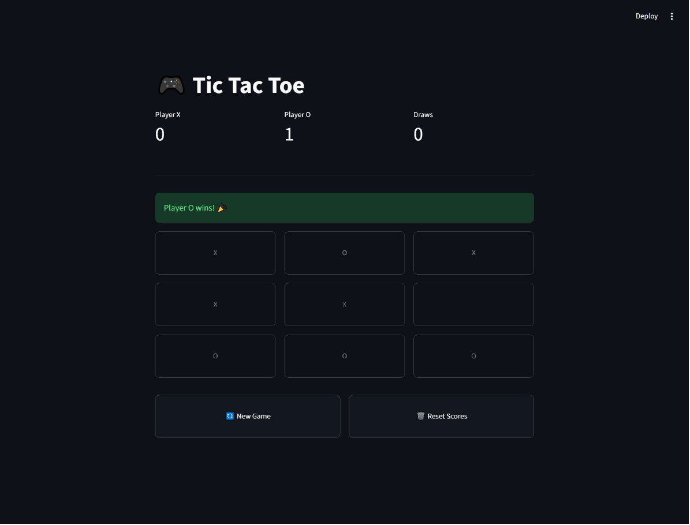

# 🎮 Tic Tac Toe (Streamlit)

A two-player Tic Tac Toe game where the board and winner-checking logic are built with NumPy,
and the interface is built with Streamlit. The game was first written as a terminal app
and then converted into an interactive web UI.

🔗 **Live Demo:** <your-streamlit-link>

## Screenshots




## Features
- 3x3 clickable board
- Turn indicator for Player X and Player O
- Win and draw detection (rows, columns, diagonals)
- Scoreboard that tracks wins and draws across games
- New Game and Reset Scores buttons
- Occupied cells are disabled so a move can't be overwritten

## Tech Stack
Python, NumPy, Streamlit

## Run Locally
```bash
git clone https://github.com/wahabsiddiqi/Tic_Tac_Toe_Game.git
cd Tic_Tac_Toe_Game
pip install -r requirements.txt
streamlit run Tic_Tac_Toe.py
```

## How It Works
The board is a 3x3 NumPy array (`1 = X`, `-1 = O`, `0 = empty`). A player wins when any row,
column or diagonal sums to 3 or -3. Streamlit's `session_state` keeps the board and scores
between clicks.

## Author
Wahab Siddiqi, BS Computer Science student, NFC IET Multan
